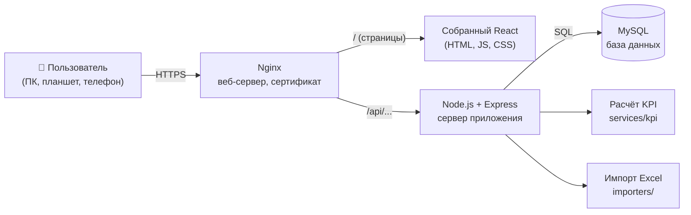

# 1. Архитектура веб-приложения «МВС СТ · Ход работ»

> Документ для владельца проекта. Объясняет, **из каких частей** состоит приложение, **зачем** каждая
> нужна и **как** они общаются. Технические слова поясняются при первом упоминании.

---

## 1.1. Что есть сейчас и что меняется

Сейчас дашборд — это набор HTML-файлов: оболочка `index.html` и четыре модуля (`schools`, `mkd`,
`networks`, `streets`). Данные встроены прямо в файлы, а правки хранятся **в браузере** (localStorage).

| Сейчас (HTML-файлы) | Станет (веб-приложение) |
|---|---|
| Данные видит только тот браузер, где их внесли | Все видят одни и те же данные из MySQL |
| Передача данных — резервными копиями `.json` | Ничего передавать не нужно: открыл сайт — данные свежие |
| Нет входа и ролей: кто открыл файл, тот и правит | Вход по логину; руководство смотрит, ответственные вносят |
| Формулы расчёта живут в коде каждого модуля | Формулы — в одном месте на сервере; сводка считается одинаково для всех |
| Журнал изменений — в браузере | Журнал — в базе, его нельзя «потерять» или подделать |
| Файл streets.html весит 14 МБ (карта внутри) | Карта подгружается кусочками из интернета, страница лёгкая |

Что **сохраняем**: деление «одно направление — один раздел», все разделы и графики модулей, формат
показателей для «Сводки», пороги отставания, журнал изменений, отчётные недели.

---

## 1.2. Главный вопрос: нужна ли бизнес-логика на другом языке?

**Короткий ответ: серверная часть нужна обязательно, но другой язык — нет.**
И фронтенд, и сервер пишем на **JavaScript**: в браузере — React, на сервере — **Node.js**.

### Почему без сервера нельзя

Браузер **не может и не должен** подключаться к MySQL напрямую:

1. **Безопасность.** Чтобы подключиться к базе, нужен пароль от неё. Всё, что попадает в браузер, может
   увидеть любой пользователь (F12 → «Исходный код»). Пароль от базы утечёт в первый же день.
2. **Права.** Только сервер может надёжно проверить: «этот человек — ответственный за МКД, ему можно
   менять МКД, но нельзя трогать Сети». Проверку в браузере легко обойти.
3. **Единые расчёты.** Готовность, план на дату, статусы «Отставание/Критично» должны считаться
   **одинаково для всех**. Если считает каждый браузер сам — у руководителя и исполнителя могут
   получиться разные цифры (другая дата на компьютере, старая версия страницы).
4. **Журнал.** Запись «кто и когда изменил» должен делать сервер — иначе её можно подделать.
5. **Загрузка Excel.** Разбор отчётов благоустройства, проверка и запись тысяч строк — работа сервера.

### Почему Node.js, а не PHP / Python / C#

| Вариант | Плюсы | Минусы для вашего случая | Вывод |
|---|---|---|---|
| **Node.js (JavaScript)** | Один язык во всём проекте. Формулы из текущих модулей уже написаны на JS — переносим почти как есть. Огромное сообщество, есть библиотеки для MySQL, Excel, входа | Нужен хостинг с поддержкой Node.js (VPS или свой сервер) | ✅ **Выбираем** |
| PHP | Работает на любом дешёвом хостинге | Второй язык для изучения; формулы придётся переписывать на PHP и поддерживать две копии | Только если хостинг умеет **только** PHP |
| Python (Django/FastAPI) | Удобен для анализа данных | Второй язык; анализа «больших данных» здесь нет | Не нужен |
| C# / Java | Корпоративный стандарт | Сложнее для начинающего, тяжелее хостинг | Избыточно |

> 💡 **Совет.** Для новичка «один язык везде» — огромное облегчение: одни и те же правила синтаксиса,
> одни инструменты (VS Code, npm), и функцию расчёта можно даже использовать и на сервере, и в браузере.

### Где какая логика живёт

| Логика | Где | Почему |
|---|---|---|
| Вход, проверка пароля, роли и права | Сервер | Безопасность |
| Расчёт готовности, плана, статусов, KPI сводки | Сервер (`server/src/services/kpi/`) | Одинаковые цифры для всех |
| Проверка вводимых данных (процент 0–100, дата — дата) | **И** браузер (подсказка сразу), **и** сервер (окончательно) | Браузерную проверку можно обойти |
| Журнал изменений | Сервер (в той же транзакции, что и изменение) | Нельзя «забыть» записать |
| Разбор Excel | Сервер | Тяжёлая работа, доступ к базе |
| Фильтры, сортировка, графики, тема, вкладки | Браузер (React) | Быстро, без запросов к серверу |

---

## 1.3. Общая схема



Как это работает на примере «ответственный внёс статус позиции МКД»:

1. Браузер отправляет `PUT /api/mkd/periods/2026-10-26/status` с новыми значениями.
2. Сервер проверяет: вошёл ли пользователь? назначен ли он администратором ответственным **за этот адрес**?
   период не закрыт? числа корректны?
3. В одной **транзакции** (всё или ничего) сервер записывает статус в `mkd_item_status` и строку в `audit_log`.
4. Сервер пересчитывает показатели МКД и сохраняет снимок в `kpi_snapshots`.
5. Браузер получает ответ «готово» и обновляет таблицу. Руководитель, открывший «Сводку», видит новые цифры.

---

## 1.4. Технологии (стек)

| Часть | Технология | Зачем |
|---|---|---|
| Язык | JavaScript (ES2023) | Один язык везде |
| Среда выполнения сервера | **Node.js 24 LTS** | LTS = долгосрочная поддержка, обновления безопасности несколько лет |
| Веб-фреймворк сервера | **Express 5** | Самый популярный и простой: «получил запрос → ответил» |
| Драйвер MySQL | **mysql2** (promise-версия) | Пишем обычный SQL, видно, что происходит — полезно для обучения |
| Проверка данных | **zod** | Описываем «какими должны быть данные», он проверяет и пишет понятные ошибки |
| Пароли | **bcryptjs** | Хеширование паролей; чистый JS — ставится на Windows без компиляторов |
| Сеансы входа | **express-session + express-mysql-session** | Сеанс хранится в MySQL (таблица `sessions`), браузер получает защищённую cookie |
| Защита заголовков | **helmet**, **express-rate-limit** | Базовая защита от типовых атак и подбора пароля |
| Excel | **exceljs** | Чтение и создание `.xlsx` |
| Загрузка файлов | **multer** | Приём файлов от браузера |
| Фронтенд | **React 19** + **Vite** | React — интерфейс из компонентов; Vite — быстрая сборка и «живая» перезагрузка при разработке |
| Маршруты страниц | **React Router 7** | Адреса `/mkd`, `/networks/objects/rec7` |
| Запросы к API | **TanStack Query** | Кэш, повторные запросы, индикаторы загрузки — без ручного кода |
| Графики | **Recharts** | Столбцы, линии, S-кривые — простыми компонентами |
| Карта | **Leaflet + react-leaflet** | Карта благоустройства на основе OpenStreetMap |
| Стили | Обычный CSS + CSS-переменные | Переносим цвета и темы (светлая/тёмная) из текущего дашборда |
| Веб-сервер | **Nginx** | HTTPS, раздача статики, проксирование `/api` в Node.js |
| Менеджер процессов | **PM2** | Держит сервер запущенным, перезапускает при сбое и после перезагрузки |

> Точные версии библиотек будут записаны в `package.json` на шаге 2 — так установка у вас и на сервере
> будет одинаковой.

---

## 1.5. Структура проекта (папки и файлы)

```
mvs-app/
├─ README.md                  ← начните отсюда: что это и порядок шагов
├─ docs/                      ← документация (этот файл, база данных, развёртывание)
├─ database/
│  ├─ schema.sql              ← создание всех таблиц (шаг 1, готово)
│  └─ migrations/             ← будущие изменения структуры: 002_add_xxx.sql …
├─ server/                    ← СЕРВЕР (Node.js)
│  ├─ package.json            ← список библиотек и команды (npm run dev, npm start)
│  ├─ .env.example            ← образец настроек (пароль к базе и т.п.); реальный .env не публикуется
│  └─ src/
│     ├─ index.js             ← точка запуска
│     ├─ app.js               ← настройка Express: защита, сеансы, маршруты
│     ├─ config.js            ← чтение настроек из .env
│     ├─ db.js                ← подключение к MySQL, помощник для транзакций
│     ├─ middleware/          ← «прослойки»: проверка входа, ролей, ошибок, данных
│     ├─ routes/              ← адреса API: auth, users, overview, schools, mkd, networks, streets, audit
│     ├─ services/
│     │  ├─ kpi/              ← ВСЯ бизнес-логика расчётов: schools.js, mkd.js, networks.js, streets.js, summary.js
│     │  ├─ audit.js          ← запись в журнал
│     │  └─ dates.js          ← общие функции дат (понедельник недели, план на дату)
│     ├─ importers/           ← перенос из старых HTML, загрузка Excel благоустройства
│     └─ scripts/             ← служебные команды: create-admin, import-legacy, recalc-kpi
└─ client/                    ← ФРОНТЕНД (React)
   ├─ package.json
   ├─ index.html
   ├─ vite.config.js          ← при разработке перенаправляет /api на сервер
   └─ src/
      ├─ main.jsx, App.jsx    ← запуск и таблица маршрутов
      ├─ api/                 ← функции запросов к серверу (по одному файлу на направление)
      ├─ auth/                ← вход, «кто я», защита страниц по ролям
      ├─ layout/              ← каркас: шапка, вкладки направлений, тема, меню пользователя
      ├─ components/          ← общие «кирпичики»: KpiTile, StatusBadge, ProgressBar, DataTable, Modal…
      ├─ pages/
      │  ├─ overview/         ← «Сводка»
      │  ├─ schools/  mkd/  networks/  streets/
      │  └─ admin/            ← пользователи, справочники, пороги, журнал
      ├─ styles/              ← tokens.css (цвета, темы), base.css, адаптивность
      └─ utils/format.js      ← числа, деньги, даты по-русски: «1,7 млрд ₽», «26.10.2026»
```

---

## 1.6. Представление: экраны и навигация

Адреса совпадают с текущими (`#overview`, `#schools` …), только без решётки.

| Адрес | Экран | Кто видит | Что внутри (как в текущих модулях) |
|---|---|---|---|
| `/login` | Вход | все | логин, пароль |
| `/` | **Сводка** | все | карточки 4 направлений: факт/план, статус, деньги, люди/техника, 3 своих показателя, «Наибольшее отставание» (клик → карточка объекта) |
| `/schools` | Капремонт школ | все | Обзор (готовность по объектам и направлениям, S-кривая), Ресурсы, Закупки, Испытания, МГЭ, Ганта, Тепловая карта, Журнал |
| `/schools/:id` | Карточка школы | все; правка — ответственный/admin | объёмы план/факт, история выполнения по дням, ресурсы на дату, закупки, испытания, МГЭ |
| `/schools/input` | Ежедневный ввод | ответственный/admin | выбор даты; по своим школам: % и объёмы по видам работ, люди и техника — на здании и на благоустройстве |
| `/mkd` | Капремонт МКД | все | сводная по лотам, реестр адресов, позиции, финансы (договор → КС-2 → оплата), просрочки |
| `/mkd/:id` | Карточка адреса | все; правка — ответственный/admin | позиции адреса и их статусы по отчётным периодам |
| `/mkd/input` | Ввод за период | ответственный/admin | позиции **своих** адресов за выбранный период: статус, %, КС-2, оплачено |
| `/networks` | Сети | все | Обзор, Реестр объектов, Динамика, График работ, Матрица недель, Финансы, Качество данных |
| `/networks/:id` | Карточка объекта | все; правка — ответственный/admin | договоры, линии, факт по отчётным периодам |
| `/networks/input` | Панель ввода | ответственный/admin | по **своим** объектам: факт по линиям, КС, рабочие, техника за период |
| `/streets` | Благоустройство | все | программы КБУ / текущий ремонт, карта, объекты, динамика по отчётам, замечания |
| `/streets/input` | Ручной ввод отчёта | ответственный/admin | новый отчёт на дату (заполняется из предыдущего); по своим объектам: факт по видам работ, статус, люди, техника, замечания |
| `/streets/import` | Загрузка отчёта | editor/admin | выбор `.xlsx`, предпросмотр, подтверждение |
| `/admin/users` | Пользователи | admin | создание, роль (Редактор / Просмотр / Руководство), видимые направления, сброс пароля |
| `/admin/assignments` | Ответственные за объекты | admin | для каждого объекта — кто вносит данные; массовое назначение по фильтру (лот, раздел, округ) |
| `/admin/periods` | Отчётные периоды | admin | открыть / закрыть период МКД и Сетей |
| `/admin/dictionaries` | Справочники | admin | сотрудники, организации, виды работ, пороги |
| `/audit` | Журнал изменений | все (editor — по своим направлениям) | фильтры, поиск, выгрузка CSV |

### Адаптивность (телефон, планшет, ПК)

- **Подход «сначала телефон»** (mobile first): базовые стили — для узкого экрана, на широких добавляем колонки.
- Ширины: до **640 px** — телефон, **640–1024** — планшет, больше **1024** — компьютер.
- Вкладки направлений: на ПК — строка вверху; на телефоне — горизонтальная прокрутка или нижнее меню.
- Широкие таблицы (реестр 154 объектов): на ПК — таблица с закреплённой первой колонкой; на телефоне —
  **карточки** (адрес, факт/план, статус) с раскрытием подробностей.
- Графики сами подстраиваются под ширину (`ResponsiveContainer` в Recharts).
- Поля ввода — крупные (не меньше 44 px по высоте), чтобы попадать пальцем; числовые поля открывают цифровую клавиатуру (`inputMode="decimal"`).
- Тема: светлая/тёмная, по умолчанию — как в системе; выбор запоминается.

### Роли в интерфейсе

| Роль | Видит | Вносит |
|---|---|---|
| Администратор | всё | всё; назначает роли, направления и ответственных за объекты |
| Руководство | сводку и все направления | — |
| Редактор (в т.ч. кураторы) | сводку и направления, открытые ему администратором | только по объектам, за которые назначен ответственным |
| Просмотр | сводку и направления, открытые ему администратором | — |

На экранах ввода редактор видит **только свои объекты**; в реестрах они отмечены значком «мой».
Кнопки «Изменить», «Внести за период», «Загрузить отчёт» показываются только тем, у кого есть право.
Но это лишь удобство: **окончательно права проверяет сервер** при каждом запросе.

---

## 1.7. API — адреса сервера

API (интерфейс программирования) — это «меню» сервера: список адресов, по которым браузер просит
данные или сохраняет их. Все ответы — в формате JSON.

| Метод и адрес | Назначение | Права |
|---|---|---|
| `POST /api/auth/login` · `POST /api/auth/logout` · `GET /api/auth/me` | вход, выход, «кто я» | все |
| `POST /api/auth/change-password` | смена своего пароля | вошедшие |
| `GET /api/overview` | сводка: показатели всех направлений | вошедшие |
| `GET /api/directions/:code/kpi?asOf=` | показатели направления на дату | вошедшие |
| `GET /api/directions/:code/kpi/history` | история показателей (для графика динамики) | вошедшие |
| `GET/POST/PUT /api/people`, `/api/organizations` | справочники | чтение — все, запись — admin |
| `GET/POST/PUT /api/users`, `PUT /api/users/:id/directions` | пользователи, роли, видимые направления | admin |
| `GET /api/assignments?direction=` · `PUT /api/assignments` | ответственные за объекты (просмотр / пакетное назначение) | admin |
| `GET /api/periods?direction=` · `POST /api/periods` · `PUT /api/periods/:start/close` | отчётные периоды | чтение все / запись admin |
| `GET /api/schools` · `GET /api/schools/:id` | школы с расчётами | вошедшие |
| `PUT /api/schools/:id/works?date=` · `/materials` · `/systems` · `/expertise` · `/finance` | правка школы (работы — с датой, пишутся в историю) | ответственный, admin |
| `GET /api/schools/:id/history?from=&to=` | история выполнения по дням | вошедшие |
| `GET/PUT /api/schools/resources?date=` | ресурсы за день (здание + благоустройство) | чтение все / запись ответственный |
| `GET /api/mkd/objects?period=` · `GET /api/mkd/objects/:id?period=` | адреса и позиции с расчётом | вошедшие |
| `PUT /api/mkd/periods/:start/status` | пакетный ввод статусов за период | ответственный, admin |
| `POST/PUT /api/mkd/objects`, `/api/mkd/items` | правка адресов и позиций | admin (паспорт); ответственный — примечания |
| `GET /api/networks/objects?period=` · `GET /api/networks/objects/:id` | объекты с расчётом | вошедшие |
| `PUT /api/networks/periods/:start/facts` | пакетный ввод факта, КС, ресурсов | ответственный, admin |
| `GET /api/networks/dynamics` · `GET /api/networks/quality` | динамика по неделям, качество данных | вошедшие |
| `GET /api/streets/reports?program=` · `GET /api/streets/reports/:id` | отчёты благоустройства | вошедшие |
| `POST /api/streets/import` | загрузка Excel-отчёта | editor(Благоустр.), admin |
| `POST /api/streets/reports` · `PUT /api/streets/reports/:id/objects/:objectId` | новый ручной отчёт (из предыдущего) / ввод по объекту | ответственный, admin |
| `GET /api/audit` · `GET /api/audit/export.csv` | журнал изменений | вошедшие |
| `GET /api/:direction/export.xlsx` | выгрузка в Excel | вошедшие |

---

## 1.8. Бизнес-правила (точно как в текущих модулях)

Эти правила переносятся в `server/src/services/kpi/`. Ниже — словами, чтобы их мог проверить
специалист по направлению, а не только программист.

### Общие понятия

- **План на дату** — линейно: если работа идёт с 1 мая по 1 сентября, то 1 июля план = 50 %.
  До начала — 0 %, после окончания — 100 %.
- **Отклонение** = факт − план (в процентных пунктах, п.п.). −12 п.п. значит «отстаём на 12 пунктов».
- **Статус направления в Сводке:** отклонение < −10 п.п. — 🔴 Критично; < −2 п.п. — 🟠 Отставание; иначе 🟢 В графике.
- **Отчётные периоды (МКД, Сети)** — два в неделю: **пн–ср** и **чт–вс**. План считается на последний
  день периода (ср или вс). Исключение — недели, перенесённые из старых HTML-файлов: для них план, как и
  раньше считали модули, — в МКД на пятницу недели, в Сетях на понедельник. Состояние на период — последняя запись **не позже** этого периода (если за период
  ничего не вносили — действует предыдущее значение). Период открывается автоматически при первом вводе,
  закрывает его администратор.

### Капремонт школ

- Факт по виду работ на школе = `факт объёма / проектный объём` (не больше 100 %), а если объёмов нет — введённый %.
- Готовность ДКР = Σ (вес вида работ × факт). Веса — справочник «Светофор» (сумма сейчас 0,83).
- План = Σ (вес × план на сегодня), где даты начала/окончания — у **вида работ** (общие для всех школ).
- Статус школы: факт ≥ 99,9 % — выполнено; план и факт = 0 — не начато; отклонение < −10 п.п. — критично; < −2 п.п. — отставание.
- «Отставание, дн.» — на сколько дней назад нужно отмотать график, чтобы план сравнялся с текущим фактом.
- Ресурсы = люди на здании + люди на благоустройстве; техника — так же; на последнюю дату.
- Выполнение вносится **каждый день** и хранится историей: фактическая S-кривая строится по реальным
  значениям прошлых дней, а не только по текущему состоянию.

### Капремонт МКД

- Состояние позиции на период — последняя запись **не позже** этого периода.
- Статусы `ks` (КС-2 подписаны) и `paid` (оплачено) = 100 % готовности. `excl` (исключено) — не участвует в расчётах.
- План позиции — линейно по её срокам на **дату плана** периода (ср или вс; для старых недель — пятница).
- Готовность адреса и направления — средняя по позициям, **взвешенная стоимостью договора**.
- Риск: просрочена (срок прошёл, < 100 %) — критично; отклонение < −15 п.п. — критично; < −5 п.п. или «Приостановлено» — отставание.
- Деньги: Договор, Закрыто КС-2, Оплачено, К оплате = КС-2 − оплачено.

### Сети, коллекторы, водные объекты

- Факт объекта: если все линии в одних единицах (п.м) — `Σ факт / Σ проект` (факт по линии не больше проекта);
  если единицы разные — среднее из долей по линиям.
- План объекта — линейно между началом и окончанием объекта на дату плана периода.
- Итог направления — взвешен **стоимостью договоров** объекта.
- Статус: факт ≥ 99,5 % — выполнено; план и факт ≈ 0 — не начато; отклонение ≥ −5 п.п. — в графике; ≥ −15 п.п. — отставание; иначе — критично.
- Деньги: стоимость договоров, аванс, закрыто КС (накопительно по неделям).

### Благоустройство улиц

- Отчёт на дату появляется загрузкой Excel **или** вручную: новый отчёт заполняется данными предыдущего,
  ответственные исправляют факт, статус, людей, технику и замечания по своим объектам.
- Для сводки берётся последний отчёт программы КБУ.
- Готовность = доля позиций (объект × вид работ с проектным объёмом), где факт ≥ проекта.
- «Завершены» — статусы «Работы завершены» и «Сдан ЦККБ».
- Плана в отчёте нет, поэтому отставание не считается.

---

## 1.9. Формат показателей направления (KPI payload)

Сервер отдаёт для «Сводки» по каждому направлению объект такого вида (тот же формат, что сейчас
используют модули — это облегчит перенос интерфейса):

```js
{
  asOf: '2026-10-26', asOfKind: 'week',        // на какую дату; 'week' | 'report' | 'updated'
  objects: 154, unit: 'объектов',
  lagging: 35, critical: 16,                    // null — если графика нет
  fact: 0.33, plan: 0.37,                       // доли 0..1
  factLabel: 'Выполнение (взвешенное по стоимости договоров)',
  people: 968, tech: 159,
  money: { portfolio: 6923331935, portfolioLabel: 'Договоры', closed: 1746083000, paid: null },
  kpis: [ { l: 'Проложено и отремонтировано', v: '16 120 п.м' }, … ],   // 3 своих показателя
  attention: [ { id, name, sub, d /* факт−план */, crit } ],             // до 8 худших
  remarks: [ … ], extra: { label, value }       // для благоустройства
}
```

---

## 1.10. Безопасность — минимум, который будет сделан

- Пароли — только в виде bcrypt-хеша; после 5 неудачных попыток вход блокируется на 15 минут.
- Cookie сеанса: `HttpOnly` (недоступна скриптам), `Secure` (только HTTPS), `SameSite=Lax`.
- Все SQL-запросы — с параметрами (`?`), никакой склейки строк → защита от SQL-инъекций.
- Пользователь базы для приложения имеет права **только** на свою базу и без права `DROP`/`GRANT`.
- Файл `.env` с паролями не попадает в Git и не лежит в папке, доступной из интернета.
- HTTPS-сертификат Let's Encrypt (бесплатно), автоматическое продление.
- Ежедневная резервная копия базы (см. руководство по развёртыванию).

---

## 1.11. План работ по шагам

| Шаг | Что делаем | Результат |
|---|---|---|
| **1** | ✅ Структура базы, архитектура, руководство по развёртыванию | `schema.sql`, документация |
| 2 | Сервер: каркас Express, подключение к MySQL, вход и роли, `create-admin` | Можно войти через API |
| 3 | Перенос данных из текущих HTML-модулей в MySQL (скрипт `import-legacy`) | Реальные данные в базе |
| **4** | ✅ Бизнес-логика: расчёт KPI четырёх направлений + `GET /api/overview`; `npm run verify-kpi` — все поля совпадают с `kpi_defaults.json` | Сводка считается на сервере |
| **5** | ✅ Фронтенд: каркас React, вход и смена временного пароля, тема, «Сводка» (проверено на ПК и телефоне) | Первая страница в браузере |
| 6 | Направления по очереди: ✅ МКД (реестр, карточка, ввод за период) → ✅ Сети (реестр по разделам, карточка с динамикой, ввод) → Школы → Благоустройство | Полный функционал |
| 7 | Администрирование, журнал, выгрузки Excel, загрузка отчётов | Готово к работе |
| 8 | Развёртывание на сервере, HTTPS, резервные копии | Приложение в интернете / в сети организации |

> 💡 На шаге 4 у нас есть отличная «контрольная работа»: файл `src/kpi_defaults.json` из вашего архива
> содержит показатели, которые считают текущие модули. Серверный расчёт должен дать **те же числа**.
