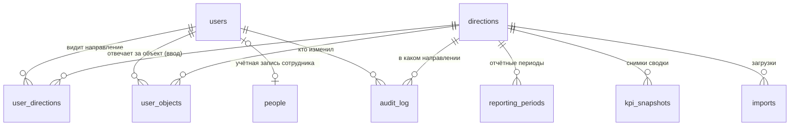
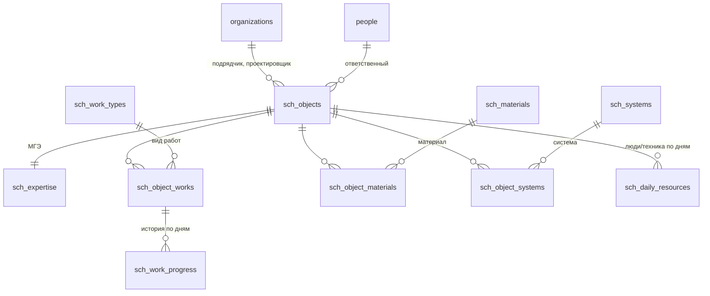
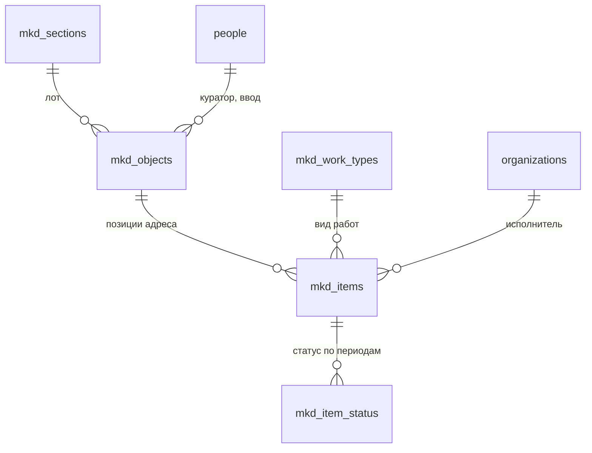
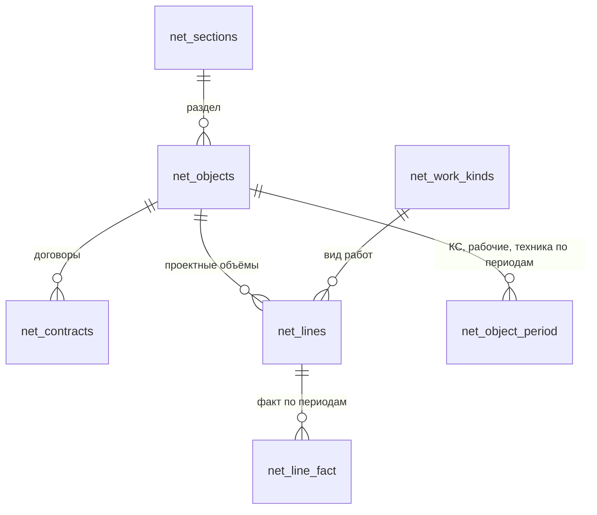
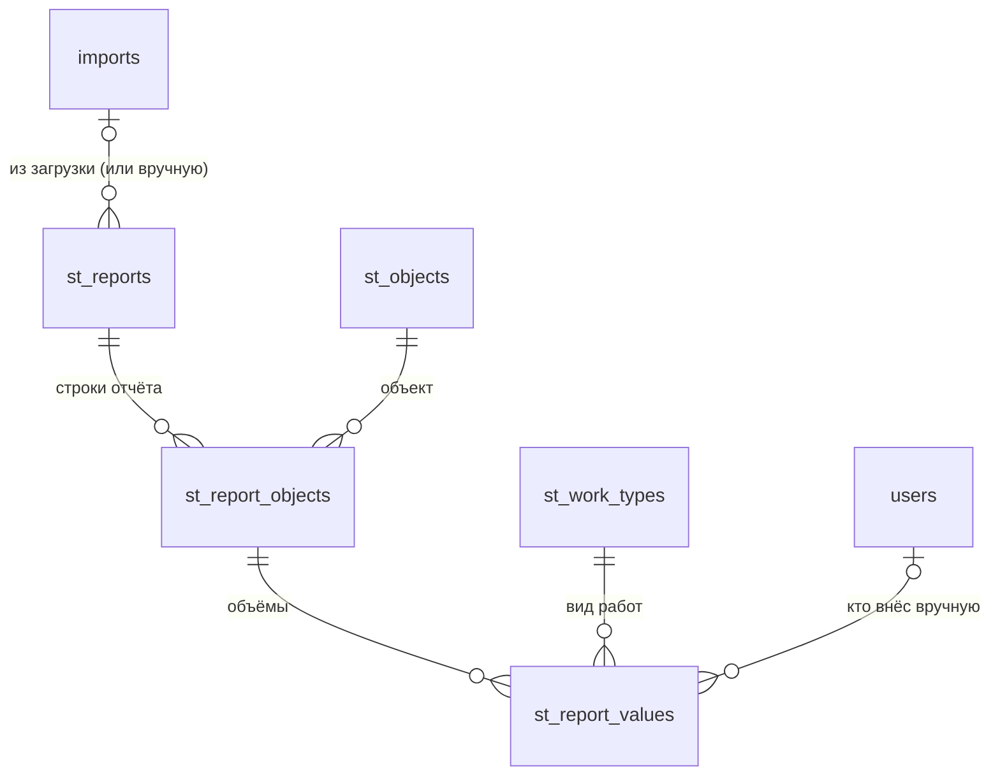

# 2. База данных MySQL — пояснения

> Сам скрипт создания — [`database/schema.sql`](../database/schema.sql). Здесь — что в нём и почему так.

---

## 2.1. Пять минут теории

- **Таблица** — как лист Excel: строки (записи) и столбцы (поля). У каждого поля строгий тип: число, дата, текст.
- **Первичный ключ (PRIMARY KEY)** — поле, по которому строку можно найти однозначно (обычно `id`).
- **Внешний ключ (FOREIGN KEY)** — ссылка на строку другой таблицы. Например, `mkd_items.object_id` → `mkd_objects.id`:
  «эта позиция относится к этому адресу». База не даст сослаться на несуществующий адрес.
- **Нормализация** — каждое значение хранится **в одном месте**. ФИО куратора записано один раз в `people`,
  а объекты ссылаются на него по `id`. Исправили ФИО — оно поменялось везде.
- **Транзакция** — пачка изменений «всё или ничего». Если на середине сбой — база откатится к исходному состоянию.
- **Индекс** — «оглавление» для быстрого поиска. Первичные и внешние ключи индексируются автоматически.
- **VIEW (представление)** — сохранённый запрос, который читается как таблица.

---

## 2.2. Общий принцип: «текущее состояние» + «история по неделям»

Текущие дашборды хранят данные в двух видах, и база повторяет это:

| Что | Где хранится | Пример |
|---|---|---|
| Паспорт объекта (адрес, сроки, договор) — меняется редко | `*_objects`, `*_items`, `net_contracts`, `net_lines` | адрес, стоимость договора |
| Ход работ — вносится регулярно | таблицы с датой или отчётным периодом в ключе | `mkd_item_status (item_id, period_start)`, `sch_work_progress (object_id, work_type_id, report_date)` |

Благодаря ключу «объект + дата/период» можно построить динамику за любой срок и не терять историю.

**Как вносятся данные по направлениям:**

| Направление | Как часто | Таблицы хода работ |
|---|---|---|
| Школы | каждый день | `sch_work_progress` (работы), `sch_daily_resources` (люди и техника на здании и на благоустройстве) |
| МКД | два раза в неделю: периоды пн–ср и чт–вс | `mkd_item_status` |
| Сети | два раза в неделю: периоды пн–ср и чт–вс | `net_line_fact`, `net_object_period` |
| Благоустройство | отчёт на дату: загрузка Excel **или** ручной ввод | `st_reports` → `st_report_objects` → `st_report_values` |

**Кто что может:**

| Роль | Видит | Вносит |
|---|---|---|
| Администратор (`admin`) | всё | всё; назначает роли, направления и ответственных за объекты |
| Руководство (`manager`) | все направления и сводку | ничего |
| Редактор (`editor`) | направления из `user_directions` | только объекты, назначенные в `user_objects` |
| Просмотр (`viewer`) | направления из `user_directions` | ничего |

Кураторы входят в систему сами — это пользователи (обычно `editor`) со своими объектами.

---

## 2.3. Схемы связей

### Общие таблицы



### Капремонт школ



### Капремонт МКД



### Сети, коллекторы, водные объекты



### Благоустройство улиц



---

## 2.4. Откуда берутся данные: старый JSON → новые таблицы

Команда `npm run import-legacy` (шаг 3, выполнен на тестовой базе 27.10.2026) читает встроенные
данные из ваших HTML-файлов и раскладывает их так. Перенесено и сверено с исходником: школ 4, адресов МКД 42
(284 позиции, 2 556 недельных статусов), объектов Сетей 154 (166 договоров, 227 линий, 2 043 значения факта),
отчётов благоустройства 140 (4 112 строк, 38 080 значений объёмов).

| Модуль | Было (JSON внутри HTML) | Стало (таблица) | Объём |
|---|---|---|---|
| Школы | `objects.o1` (name, okrug, area, fin…) | `sch_objects` | 4 |
| | `objects.o1.mge` | `sch_expertise` | 4 |
| | `ref.works.items.w13` (name, w, start, end) | `sch_work_types` | 34 |
| | `objects.o1.works.w13` (pct, pv, fv) | `sch_object_works` + первая запись истории `sch_work_progress` на дату `asOf` | 4 × 34 |
| | `ref.materials` / `objects.o1.proc` | `sch_materials` / `sch_object_materials` | 35 / 4 × 35 |
| | `ref.systems` / `objects.o1.ii` | `sch_systems` / `sch_object_systems` | 39 / 4 × 39 |
| | `log['2026-08-24_o2']` (people, tech, peopleBl, techBl) | `sch_daily_resources` (`*Bl` → `*_landscape`) | 180 |
| МКД | `sections`, `workTypes` | `mkd_sections`, `mkd_work_types` | 5, 17 |
| | `people`, `orgs` | `people`, `organizations` (общие) | 8, 5 |
| | `objects` | `mkd_objects` | 42 |
| | `items` | `mkd_items` | 284 |
| | `snaps.i1['2026-10-26']` (st, pct, ks, paid, by, at) | `mkd_item_status` (pct ÷ 100) | ≈ 2 500 |
| | `weeks` (все — понедельники) | `reporting_periods`: период пн–ср, `plan_date` = пятница (как считали модули), `is_legacy = 1` | 9 |
| Сети | `meta.sections` | `net_sections` | 5 |
| | `objects` | `net_objects` | 154 |
| | `objects[].contracts` | `net_contracts` | ≈ 160 |
| | `objects[].lines` | `net_lines` (+ `net_work_kinds`) | ≈ 250 |
| | `weekly['2026-10-26'].rec7.f.open0` | `net_line_fact` | ≈ 2 300 |
| | `weekly['2026-10-26'].rec7` (ks, w, m) | `net_object_period` | ≈ 1 400 |
| Благоустройство | `works` | `st_work_types` | 20 |
| | `snapshots[]` (program, date) | `st_reports` | 140 |
| | `snapshots[].objects[]` | `st_objects` + `st_report_objects` | 32 объекта |
| | `snapshots[].objects[].works.curbOld` (p, f, sourcePct) | `st_report_values` | ≈ 58 000 |
| | `geodata.verified` (lat, lon…) | `st_objects.lat/lon/geo_*` | 34 |

Что **не** переносится в базу:
- `mapdata` (5,9 МБ контуров карты) — карта будет загружаться из OpenStreetMap; границы округов (`geodata.districts`)
  станут маленьким статическим файлом `client/public/districts.geojson`.
- Ссылки на ячейки Excel (`cells: {p:'K5'}`) — служебная информация для сверки; при необходимости добавим поле.
- Настройки внешнего вида (тема, активная вкладка) — остаются в браузере пользователя.

> ⚠ **Проценты.** В МКД процент хранился числом 0–100, в остальных модулях — долей 0–1. В базе везде **доля 0–1**
> (`DECIMAL(7,4)`): при переносе МКД делим на 100. В интерфейсе пользователь вводит и видит привычные 0–100 %.

---

## 2.5. Полезные запросы (можно выполнить в phpMyAdmin или Workbench)

```sql
-- Сколько позиций МКД в каждом статусе на последнюю неделю
SELECT status, COUNT(*) AS n, ROUND(SUM(ks_amount)/1e6, 1) AS ks_mln
FROM mkd_item_status
WHERE period_start = (SELECT MAX(period_start) FROM mkd_item_status)
GROUP BY status;

-- Объекты Сетей без единого договора (проверка качества данных)
SELECT o.code, o.short_name FROM net_objects o
LEFT JOIN net_contracts c ON c.object_id = o.id
WHERE c.id IS NULL AND o.archived = 0;

-- Кто и что менял за последние 7 дней
SELECT created_at, user_name, entity_name, summary
FROM audit_log WHERE created_at >= NOW() - INTERVAL 7 DAY
ORDER BY created_at DESC;

-- Люди и техника на школах на последнюю дату
SELECT o.short_name, r.report_date, r.people + r.people_landscape AS people, r.tech + r.tech_landscape AS tech
FROM v_sch_resources_latest r JOIN sch_objects o ON o.id = r.object_id;

-- Кто отвечает за каждый адрес МКД
SELECT o.address, u.full_name
FROM mkd_objects o
LEFT JOIN user_objects uo ON uo.direction_id = 2 AND uo.object_id = o.id
LEFT JOIN users u ON u.id = uo.user_id
WHERE o.archived = 0 ORDER BY o.address;

-- Готовность школы по видам работ за последние 14 дней (для графика)
SELECT p.report_date, t.name, p.pct
FROM sch_work_progress p JOIN sch_work_types t ON t.id = p.work_type_id
WHERE p.object_id = 1 AND p.report_date >= CURDATE() - INTERVAL 14 DAY
ORDER BY p.report_date, t.sort_order;
```

---

## 2.6. Советы по работе с базой

1. **Никогда не правьте структуру на «боевой» базе руками.** Любое изменение — новый файл
   `database/migrations/004_что_меняем.sql` (следующий номер), то же изменение — в `schema.sql`
   и строка в его `INSERT INTO schema_migrations`. Применяется командой `npm run migrate`,
   сначала на копии. **Уже применённую миграцию не исправляют** — только следующим номером.
2. **Не удаляйте записи** — используйте `archived = 1`. Удаление ломает историю и журнал.
3. **Резервная копия перед каждым обновлением** приложения (команда — в руководстве по развёртыванию).
4. **Кодировка — только `utf8mb4`.** Обычная `utf8` в MySQL не сохраняет некоторые символы.
5. Для просмотра базы удобны бесплатные программы: **DBeaver**, **HeidiSQL** (Windows), **MySQL Workbench**.
